  

<h1 align="center">Hi, I'm Josh 👋</h1>
<h3 align="center">Full-stack developer at Project2100</h3>

  <picture>
    <source media="(prefers-color-scheme: dark)" srcset="assets/typing-dark.svg" />
    
  </picture>

Turning complex systems into tools people actually want to use.

 

<h2 align="center">About me</h2>

I'm **Josh Botha**, a developer based in Sydney, Australia. I build software, data platforms and AI-powered tools at **[Project2100](https://www.project2100.com)**.

My work sits where **thoughtful interfaces meet useful systems**: web apps, Microsoft Office add-ins, business workflows and reporting tools.

Most days I'm working with **TypeScript, React, Node.js and Azure**, connecting the interface to the data and logic behind it.

I'm especially interested in practical AI: assistants, automation and reusable agent skills that make everyday work easier.

**The goal is simple: build useful things, and make them feel good to use.**

 
 

<h2 align="center">Connect</h2>

  <a href="https://github.com/josh-botha-p2100">GitHub</a>
  &nbsp; / &nbsp;
  <a href="https://www.project2100.com">Project2100</a>
  &nbsp; / &nbsp;
  <a href="mailto:josh@project2100.com">Email me</a>

 

<h2 align="center">Tech stack</h2>

   &nbsp;
   &nbsp;
   &nbsp;
   &nbsp;
  

   &nbsp;
   &nbsp;
   &nbsp;
  

Also working with Power BI, Azure Functions and Microsoft Office add-ins.

 

<h2 align="center">GitHub stats</h2>

  <picture>
    <source media="(prefers-color-scheme: dark)" srcset="assets/stats-dark.svg" />
    
  </picture>

<h2 align="center">Activity graph</h2>

  <picture>
    <source media="(prefers-color-scheme: dark)" srcset="assets/activity-dark.svg" />
    
  </picture>

Most of my work lives in private repositories. These charts reflect GitHub's contribution calendar.

 

<h2 align="center">Out in the open</h2>

  <a href="https://github.com/josh-botha-p2100/p2100-skills"><strong>p2100-skills ↗</strong></a> 
  Reusable agent skills for Project2100 workflows.

 

Always learning. Always building.

