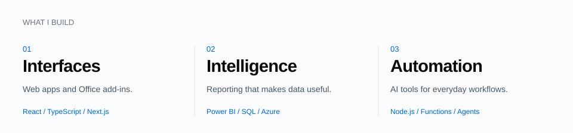

<picture>
  <source media="(max-width: 600px) and (prefers-reduced-motion: reduce)" srcset="assets/profile-hero-mobile-static.svg" />
  <source media="(max-width: 600px)" srcset="assets/profile-hero-mobile.svg" />
  <source media="(prefers-reduced-motion: reduce)" srcset="assets/profile-hero-static.svg" />
  
</picture>

 

**I build the interface, the logic and the connections in between.**

At [Project2100](https://www.project2100.com), I work across web applications, Microsoft Office add-ins, business intelligence and AI-assisted workflows. My focus is making complex systems easier to use.

[Project2100 ↗](https://www.project2100.com) &nbsp; / &nbsp; [Get in touch ↗](mailto:josh@project2100.com) &nbsp; / &nbsp; [Explore my repositories ↗](https://github.com/josh-botha-p2100?tab=repositories)

 

<picture>
  <source media="(max-width: 600px)" srcset="assets/focus-mobile.svg" />
  
</picture>

 

   &nbsp; &nbsp;
   &nbsp; &nbsp;
   &nbsp; &nbsp;
   &nbsp; &nbsp;
   &nbsp; &nbsp;
  

 

<picture>
  <source media="(max-width: 600px) and (prefers-reduced-motion: reduce)" srcset="assets/activity-3d-mobile-static.svg" />
  <source media="(max-width: 600px)" srcset="assets/activity-3d-mobile.svg" />
  <source media="(prefers-reduced-motion: reduce)" srcset="assets/activity-3d-static.svg" />
  
</picture>

GitHub contributions refresh daily. Claude and Codex show a dated snapshot of human prompts recorded locally. Column heights use a log scale within each source; they do not measure hours or productivity. [How the data works](ACTIVITY.md).

 

### Built to be reused

[**p2100-skills ↗**](https://github.com/josh-botha-p2100/p2100-skills) 
Agent skills for Project2100 workflows. Useful pieces from a day-to-day practice built around software, data and AI.

Most of my client work lives in private repositories. This is where I share what can be public.
