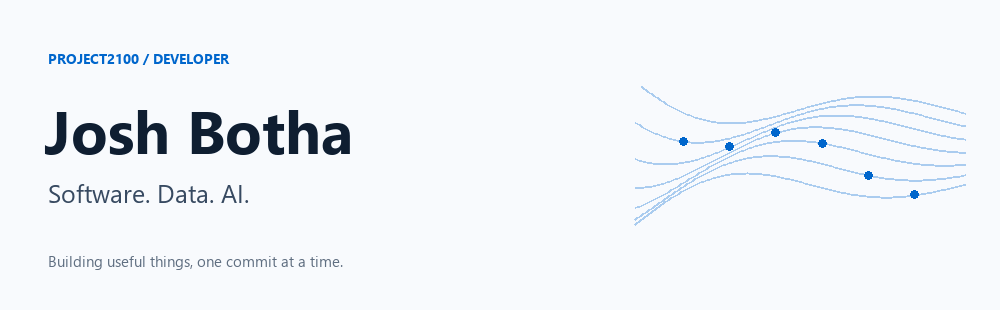

  

I build AI-powered tools, data platforms and business applications at **[Project2100](https://www.project2100.com)**. My work connects useful interfaces with the systems and data behind them.

### What I work on

- **Software:** web applications, business workflows and Microsoft Office add-ins.
- **Data:** Power BI, SQL and integrations that turn scattered information into useful reporting.
- **AI:** practical assistants, automation and reusable agent skills.

### Tools I work with

**TypeScript · React · Next.js · Node.js**  
**Azure · Azure Functions · SQL · Power BI**

### Out in the open

[**p2100-skills →**](https://github.com/josh-botha-p2100/p2100-skills)  
Agent skills for Project2100 workflows.

Much of my day-to-day work lives in private repositories. This is where I share the pieces I can make public.

---

[Project2100](https://www.project2100.com) · [Public repositories](https://github.com/josh-botha-p2100?tab=repositories)
